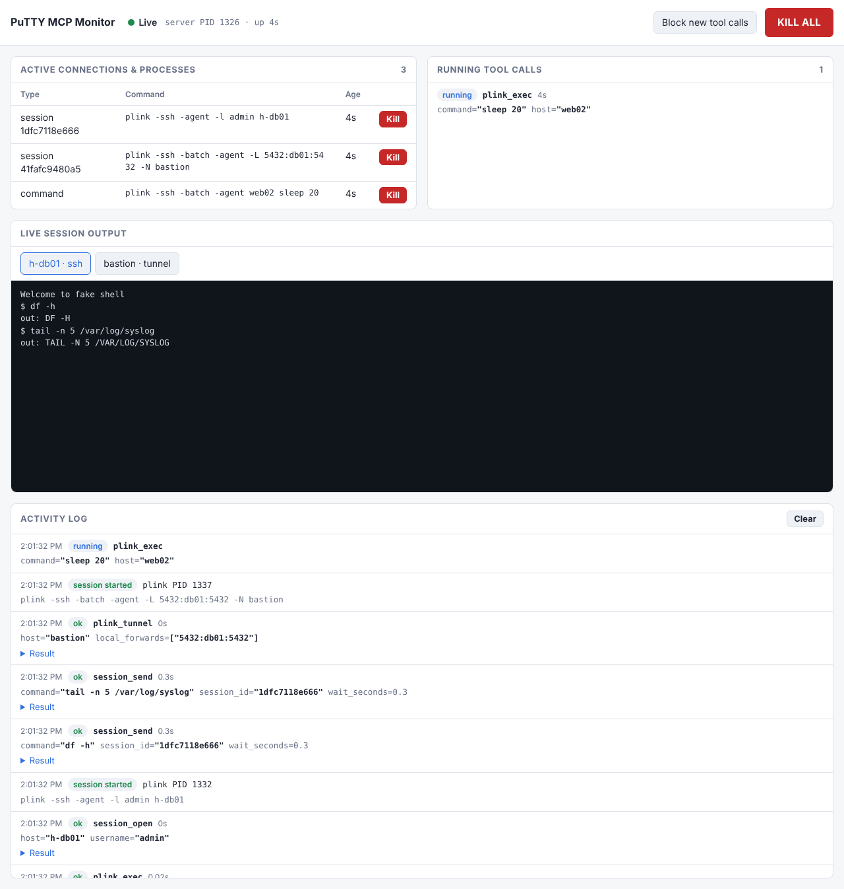

# PuTTY MCP Server

An [MCP](https://modelcontextprotocol.io/) server that gives AI assistants (Claude Code, Claude Desktop, …) the full PuTTY toolchain: SSH, Telnet, serial, SCP/SFTP, port forwarding, jump hosts, key management and PuTTY's saved sessions. It has 31 tools.

You stay in control through a local **dashboard** in your browser:
- You see every tool call live.
- You approve risky actions.
- You verify unknown host keys and type passphrases there, so the AI never sees them.
- You manage all settings there.
- A kill switch stops everything at once.

## Requirements

- Python 3.10+
- [PuTTY](https://www.chiark.greenend.org.uk/~sgtatham/putty/latest.html) (plink, pscp, psftp, pageant, putty)
- Windows for the registry and GUI tools. The plink, pscp and psftp tools also work on Linux and macOS.

Keys are generated and converted in Python, so `ssh-keygen` is not needed.

## Installation

```bash
git clone https://github.com/stephandeklonia-source/putty-mcp.git
cd putty-mcp
pip install .
```

Add the server to your MCP client, for example in `~/.claude.json` or the Claude Desktop settings:

```json
{
  "mcpServers": {
    "putty": {
      "command": "putty-mcp"
    }
  }
}
```

If you'd rather not install it, use `"command": "python", "args": ["C:/path/to/putty-mcp/putty_mcp.py"]` after `pip install -r requirements.txt`.

The server works with `mcp` 1.25+ and 2.x. 2.x is recommended: it runs tool calls in parallel, while 1.x runs them one at a time. To upgrade, use the same Python that your MCP client starts:

```powershell
python -m pip install --upgrade "mcp[cli]>=2.2,<3"
python -c "import mcp.server.mcpserver; print('mcp 2.x OK')"
```

## The dashboard



The dashboard opens in your browser the first time a tool is called. It also opens again when an approval is waiting and no dashboard tab is open. It listens only on `127.0.0.1` and needs a random token that is in its URL. The token is stored in the data folder (`dashboard-token`, readable only by you), so the link, bookmarks and open tabs keep working after a restart. *Settings → Reset link* creates a new token and makes old links stop working. The full URL also appears in the server log.

When two PuTTY MCP servers run at the same time (for example one for Cowork and one for Claude Code), the second gets its own free port and its own dashboard tab.

### Live

- **Approvals** appear at the top and wait for you. Once nobody answers within the timeout (120 s by default), the request is denied.
  - **Tool calls** that the safety rules flag: an unknown host, a risky command, a file outside your allowed folders, or a custom proxy command. Tick *Always allow …* to remember a host or folder.
  - **Unknown host keys**: compare the fingerprint with the one from the server's administrator before you click *Trust*. The AI can never accept a host key itself.
  - **Passphrases** for new or encrypted keys. What you type goes straight to the key file and never reaches the AI.
- **Connections and processes** (sessions, tunnels, running commands, PuTTY windows), each with a **Kill** button.
- **Live session output** of interactive shells.
- **Activity**: every call with its arguments, result, duration and status. A changed host key raises a red alert.
- **KILL ALL** kills every process the server started, process trees included. It denies pending approvals and blocks new tool calls until you click *Allow tool calls*.

### Settings

All runtime settings live here and are saved to `settings.json`:

| Section | What you set |
|---|---|
| Safety | When to ask (only flagged calls, every call, or never), timeout, allowed and blocked hosts (wildcards), allowed local folders, what happens with unknown hosts, local paths, proxy commands and host keys |
| Command rules | Regex rules that make a command *ask* or *deny*. They come with defaults for `rm -rf`, reboot/shutdown, disk tools, stopping services, firewall, user accounts, `chmod 777`, `crontab -r` and destructive SQL, plus `reload`, `write erase` and interface shutdown, addressing or routing changes on network devices. New default rules only reach an existing `settings.json` when you click *Restore defaults* |
| Trusted host keys | Fingerprints you trusted, with a button to remove each one |
| Sessions and output | Max sessions, idle timeout, buffer size, max output sent to the AI, stripping terminal codes |
| Serial defaults | Baud, data bits, parity, stop bits, flow control |
| PuTTY | PuTTY folder (detected executables are shown), saved-session tools on or off |
| Dashboard and audit | When to open the dashboard, desktop notifications, audit log on or off, retention |

`settings.json` and the audit log are stored in `%APPDATA%\putty-mcp` on Windows and in `~/.config/putty-mcp` elsewhere. The environment variable `PUTTY_MCP_HOME` overrides that folder.

### Audit log

Every event is appended to a daily JSONL file: tool calls with their arguments and results, approvals, kills and settings changes. Passphrases are never written. The *Audit log* tab lets you browse and filter it per day.

## Tools

| Category | Tool | Description |
|---|---|---|
| **GUI** | `putty_open` | Open a PuTTY window with connection parameters |
| | `putty_open_session` | Open a PuTTY window from a saved session |
| | `putty_serial` | Open a PuTTY window on a serial port |
| **Commands** | `plink_exec` | Run a single command on a remote host |
| | `plink_script` | Run a local script file remotely (`plink -m`); its lines are checked against the command rules |
| | `plink_tunnel` | Port forwarding (`-L`/`-R`/`-D`) or `-nc` connection |
| **Shell** | `shell_run` | Run a list of commands in one interactive shell and close it. Use it for network devices (Cisco IOS, …) and configuration blocks. It waits for each prompt, skips `--More--` pages and stops at device errors such as `% Invalid input` |
| **Sessions** | `session_open` | Open a persistent interactive session (SSH/Telnet/serial/raw) |
| | `session_send` | Send a command. Returns when the prompt comes back, when `expect` matches, or when output stops |
| | `session_read` | Read the output buffer (also after the session ended) |
| | `session_list` | List active sessions |
| | `session_close` | Close a session |
| **File transfer** | `pscp_upload` / `pscp_download` | Copy files via pscp |
| | `pscp_list` | List a remote directory |
| | `psftp_batch` | Run SFTP commands as a batch |
| | `psftp_interactive` | Persistent SFTP session (use with `session_send`) |
| **Keys** | `keygen_create` | Generate Ed25519, RSA or ECDSA keys (OpenSSH, `.pub`, `.ppk`), optionally with a passphrase entered in the dashboard |
| | `keygen_fingerprint` | SHA256 or MD5 fingerprint of a `.pub`, `.ppk` or private key |
| | `keygen_convert` | Private key to PPK (an encrypted key stays encrypted), or the public key as OpenSSH/RFC4716/PKCS8/PEM |
| | `keygen_public_key` | Public key in `authorized_keys` format |
| | `pageant_add` | Load keys into Pageant |
| | `pageant_list` | List keys in Pageant |
| **Saved sessions** | `saved_sessions_list` | List PuTTY sessions from the registry |
| | `saved_session_get` | Read a saved session |
| | `saved_session_create` | Create or update a saved session (asks for approval) |
| | `saved_session_delete` | Delete a saved session (asks for approval) |
| **Utility** | `test_connection` | Test an SSH or Telnet connection |
| | `get_host_key` | Show a server's host key fingerprint without trusting it |
| **Multi-hop** | `proxy_session` | Interactive session via a custom `-proxycmd` |
| | `chain_exec` | Run a command via one or more jump hosts (`user@host:port`); trusted keys apply to every hop |

If you leave out `port`, PuTTY picks the protocol's default port (22 for SSH, 23 for Telnet) or the port stored in the loaded saved session.

**Network devices:** Cisco IOS and similar devices run only one command per SSH exec channel, so `plink_exec` with several lines fails with "invalid autocommand". Use `shell_run` for those. It needs no session id, so it keeps working even when the MCP client restarts the server between calls (sessions only live inside one server process).

All connections run in batch mode. Authentication has to work without prompts: use a key file (`key_file`) or Pageant.

## Start-up configuration

`config.toml` is optional. Copy it from `config.template.toml`. It sets the dashboard address (`monitor.host`, `monitor.port`, `monitor.enabled`) and logging. Its other values only seed `settings.json` on the first run; after that, change them in the dashboard.

## Security

- Commands are passed as argument lists, never through a shell (`shell=False`).
- Processes never inherit the server's stdin (the MCP protocol stream).
- Host keys are only trusted by you, in the dashboard or in PuTTY itself. A key that changed is refused and raises an alert.
- Passphrases are typed in the dashboard. They never appear on a command line, in the AI conversation or in logs. Encrypted `.ppk` files use PuTTY's PPK v3 format: Argon2id, AES-256-CBC and HMAC-SHA-256.
- Private key files get owner-only permissions.
- The dashboard API requires the token in a header (which blocks CSRF), checks the `Host` header (which blocks DNS rebinding), and sends a strict Content Security Policy. Remote output is rendered as text, never as HTML.
- Registry access is limited to `HKCU\Software\SimonTatham\PuTTY\Sessions`.

> **Limits:** the dashboard controls what happens through this server. It is not a sandbox. An assistant that also has its own shell access (like Claude Code) can still start other programs, and could even edit `settings.json`. If your MCP client gives up on a call before you answer, approving it afterwards still runs it, so keep the approval timeout below your client's tool timeout.

## Known limitations

- **Pageant** has no CLI for listing keys. `pageant_list` uses `ssh-add -L` (Pageant must run with `--openssh-config`) and otherwise opens the Pageant window.
- **DSA keys** are no longer supported. PPK files can't be used as input for conversions; convert from the OpenSSH key instead.

## Development

```bash
pip install ".[test]"
python -m pytest
```

The tests use a fake plink, so they run anywhere. When `plink`, `sshd` and `ssh-keygen` are installed, they also run against a real SSH server. When `puttygen` is installed, it checks every PPK file the server writes. CI runs on Linux and Windows.

## Project layout

```
putty_mcp.py              MCP server and all tool definitions
putty_lib/
  config.py               Start-up config and PuTTY path detection
  settings.py             Runtime settings (settings.json), edited in the dashboard
  policy.py               Decides allow / ask / deny for each tool call
  approvals.py            Requests that wait for the operator
  hostkeys.py             Unknown/changed host key detection, trusted keys
  keys.py                 Key generation, loading, fingerprints, exports
  ppk.py                  PPK v3 writer (plain and encrypted)
  executor.py             Running, tracking and killing processes
  session_manager.py      Interactive sessions with background readers
  monitor.py              Activity events, process registry, kill switch
  monitor_web.py          Dashboard HTTP API (token auth)
  monitor.html            Dashboard page
  audit.py                Daily JSONL audit log
  registry.py             Saved PuTTY sessions in the Windows registry
  utils.py                Argument building, host parsing, proxy chains
tests/                    pytest suite (fake plink + real SSH when available)
```

## License

MIT
